# Warden+

**A free, open-source app & website blocker for Android – hard to switch off, easy to live with.**

Kotlin · Jetpack Compose · on-device DNS filter · Accessibility app blocking · optional device-owner mode

> [!IMPORTANT]
> **This is NOT the original Warden project.**
> Warden+ is an unofficial, community-maintained fork of
> **[ChristopherLaughlin/warden](https://github.com/ChristopherLaughlin/warden)**.
> All credit for the original app – its architecture, blocking engine and much of the code –
> goes to the original author. Warden+ adds features and fixes on top. It is not affiliated
> with or endorsed by the original project; please report problems with Warden+ **here**.

[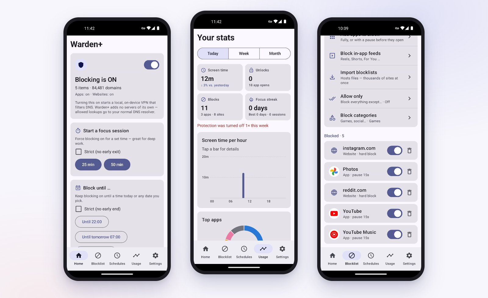](docs/images/hero.jpg)

**[⬇ Download the latest APK](https://github.com/desquerteur/warden-plus/releases/latest)** · **[Explore the gallery](#screenshot-gallery)** · **[Install guide](#install)** · **[What's new](https://github.com/desquerteur/warden-plus/releases)**

### ▶ Watch the intro · 0:51

[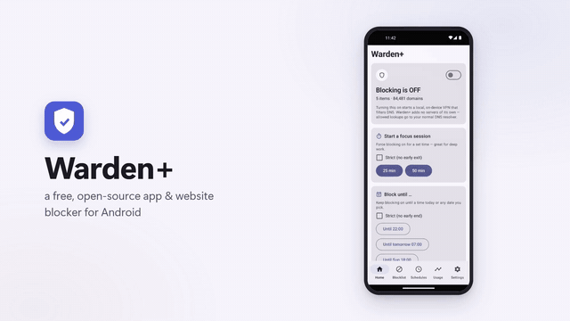](docs/videos/warden-plus-intro.mp4)

**[▶ Watch the full video (MP4)](docs/videos/warden-plus-intro.mp4)** · A 51-second tour built in code from real app captures (no sound, 60 fps); [video source](docs/videos/source/README.md).

## Contents

- [Introduction](#introduction)
- [What Warden+ adds to the original](#what-warden-adds-to-the-original)
- [Capability status and roadmap](#capability-status-and-roadmap)
- [Screenshot gallery](#screenshot-gallery)
- [First launch: setup wizard and guides](#first-launch-setup-wizard-and-guides)
- [Protection levels](#protection-levels)
- [How blocking works](#how-blocking-works)
- [Install](#install)
- [Updates](#updates)
- [Build from source](#build-from-source)
- [Tests and observed results](#tests-and-observed-results)
- [Privacy](#privacy)
- [Known limits](#known-limits)
- [License and attribution](#license-and-attribution)

## Introduction

**Warden+ blocks distracting apps and websites on your phone – and makes it genuinely hard to undo in a weak moment.** No account, no subscription, no ads, no data collection.

- **Apps and websites:** block apps via Android's accessibility service and websites in every browser and app via a local, on-device DNS filter.
- **Hosts lists:** import blocklists such as [StevenBlack/hosts](https://github.com/StevenBlack/hosts) from a file or URL – ~78,000 domains in about 1 MB of memory, refreshed weekly.
- **Your own times:** weekly schedules, focus sessions, *Block until* a time or date, one-time blocks over several days, date ranges and an end date per entry.
- **Allow only & categories:** block everything except the apps or sites you choose, or block whole categories such as **all games** – new installs included.
- **Block protection:** weakening a block needs your PIN, waits 15 min / 1 h / 24 h, or is locked until a date. Strict focus sessions can't be ended early.
- **Hard to switch off:** device-admin protection against force stop and uninstall, an opt-in settings guard, and – for experts – a device-owner mode that lets Android itself switch blocked apps off.
- **Calm and clear:** a guided setup wizard, spotlight guides with animations, usage statistics with charts, and one consistent look in light and dark mode.
- **Updates in the app:** *Settings → Updates* installs new releases signed with the same key.

## What Warden+ adds to the original

| Area | Original Warden | Warden+ |
| --- | --- | --- |
| Website blocking | Manual domain list | + hosts lists (file/URL, StevenBlack presets, weekly refresh), "Allow only" for websites |
| App blocking | Per-app block, mindful pause, limits | + "Allow only" mode, category blocking (games, social, video …), automatic blocking of new installs |
| Times | Weekly schedules, focus sessions | + *Block until*, one-time blocks, date ranges, end date per entry; clock & calendar pickers |
| Protection | Strict mode with PIN, device admin | + Block protection (PIN / Delay / Locked until) for every loosening change, strict focus that can't be bypassed, force-stop protection checklist, settings guard (warn only), device-owner mode with emergency exit |
| Reliability | – | Website filter re-arms itself after updates, reboots and schedule starts; widgets on the home screen never trigger the block screen; loop guard |
| Onboarding | Setup screen | Setup wizard on first start, spotlight guides with path animations, *Restart guide* |
| Statistics | Screen time & streak | Usage dashboard: day/week/month, bar and ring charts, trends, block counters, per-app history |
| Updates | – | In-app updater from GitHub Releases with signature check |
| Look | – | One calm style across all pages, gentle motion that respects "remove animations" |

## Capability status and roadmap

| Capability | Status in Warden+ | Evidence or next step |
| --- | --- | --- |
| Website blocking (DNS filter) | Working; re-arms after update, reboot and schedule start | Emulator acceptance runs 0.3.0–0.3.5; verify on more phones |
| App blocking (accessibility) | Working; home-screen widgets never trigger a block | Emulator runs; Samsung widget behaviour to confirm on a real Fold 4 |
| Hosts lists | StevenBlack Unified (77,758 domains) blocks `doubleclick.net`, keeps `wikipedia.org` | Emulator run 0.3.0 |
| Schedules, *Block until*, one-time blocks | Minute-accurate start and end | Emulator runs 0.3.0, 0.3.4; DST/time-zone changes only unit-tested |
| Allow only & categories | Working, incl. automatic blocking of newly installed games | Emulator run 0.3.0 |
| Block protection | PIN, Delay and Locked until enforced for every loosening change | Emulator run 0.3.0 |
| Force-stop protection | Device admin greys out *Force stop*; interruptions are detected and counted | Emulator run 0.3.2; Samsung *Active apps → Stop* to confirm on a real phone |
| Maximum protection (device owner) | Suspends blocked apps, locks VPN/uninstall/date & time, emergency exit | Emulator run 0.3.2/0.3.4 (no accounts); setup with real Google/Samsung accounts open |
| Setup wizard & guides | Working at 344 dp, with PIN-locked Settings | Emulator runs 0.3.2–0.3.5 |
| In-app updates | Accessibility and data survive updates | Emulator runs 0.2.2 → 0.3.6 |
| Automatic GitHub builds | Workflows ready | Currently paused – releases are built locally and attached by hand |

### Next milestones

- [ ] **Real-phone acceptance on a Galaxy Z Fold 4:** Samsung search-bar widget, *Active apps → Stop*, *Never sleeping apps*, cover and inner display, dark mode.
- [ ] **Device owner with real accounts:** document the account sign-out / sign-in round trip on Samsung One UI.
- [ ] **Re-enable CI releases** once the GitHub Actions account issue is resolved.
- [ ] **More hosts presets and import formats.**

## Screenshot gallery

Captures from Warden+ 0.3.6 on an emulated Galaxy Z Fold 4 cover screen (344 dp). Click an image for the full-size capture.

| 🏠 Home | 📊 Usage |
| --- | --- |
| [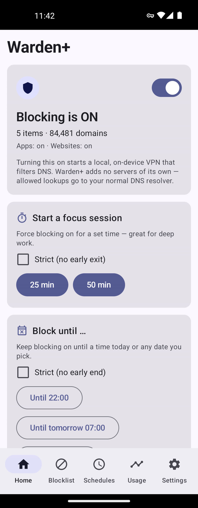](docs/images/home.jpg) | [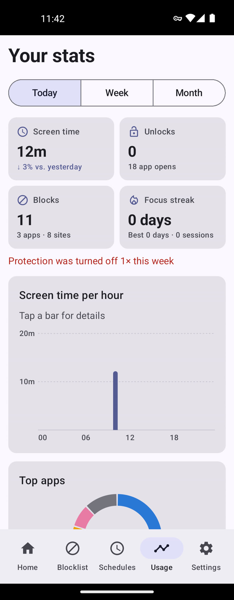](docs/images/usage.jpg) |
| Protection status at a glance; the shield pulses when blocking switches on. | Day, week and month with charts, trends and block counters. |

| 🚫 Blocklist | 🌐 Hosts lists |
| --- | --- |
| [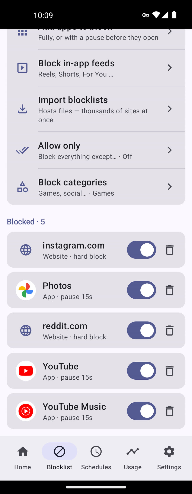](docs/images/blocklist.jpg) | [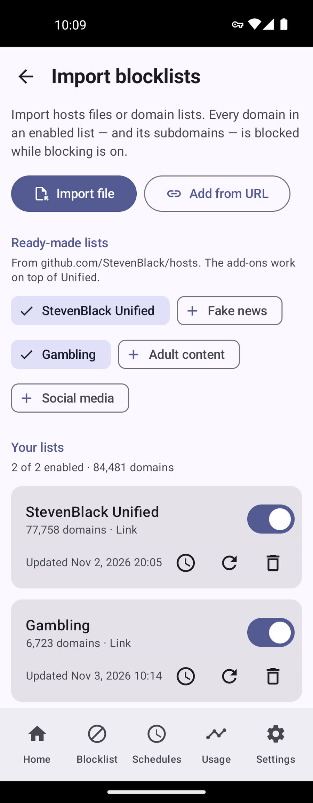](docs/images/hosts-lists.jpg) |
| Apps, websites, in-app feeds, allow-only and categories. | Import StevenBlack and other lists from a file or URL. |

| 🗓 Schedules | ⏰ Block until |
| --- | --- |
| [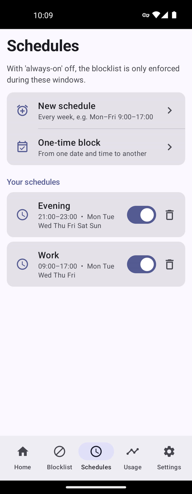](docs/images/schedules.jpg) | [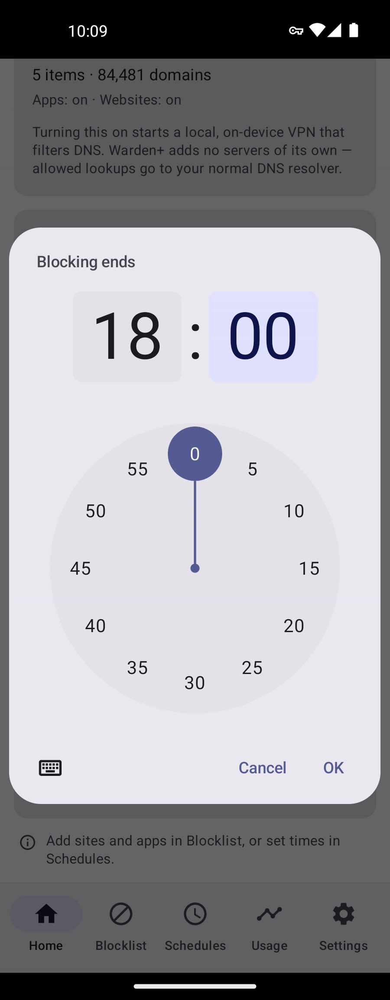](docs/images/block-until.jpg) |
| Weekly plans, one-time blocks and date ranges. | Pick the end on the clock dial and the calendar. |

| 🛡 Protection | 🔒 Maximum protection |
| --- | --- |
| [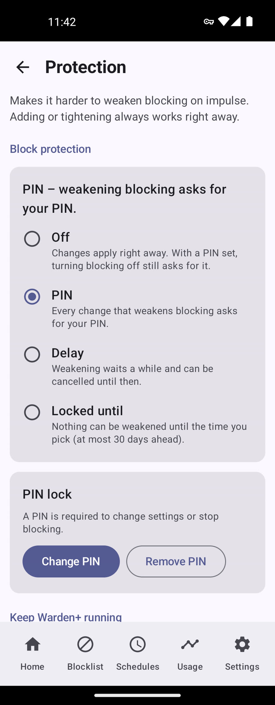](docs/images/protection.jpg) | [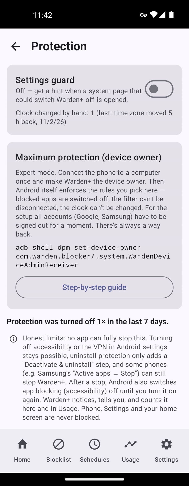](docs/images/max-protection.jpg) |
| Block protection, PIN and the force-stop checklist. | Device-owner mode with an emergency exit. |

| 🧭 Setup wizard | ✨ Spotlight guide |
| --- | --- |
| [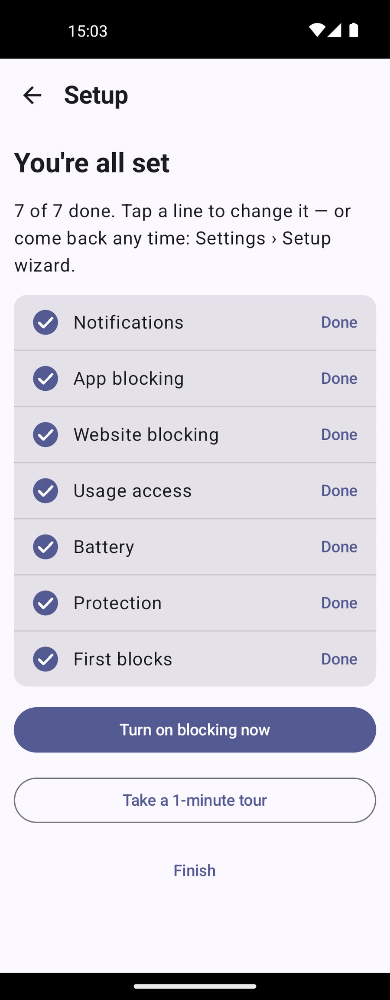](docs/images/wizard.jpg) | [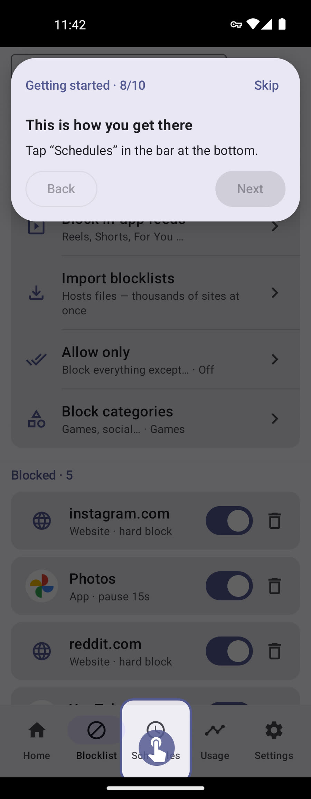](docs/images/guide.jpg) |
| Every permission step by step; steps tick themselves off. | A finger shows the way to each place in the app. |

| 🌙 Dark mode | 🌬 Pause screen |
| --- | --- |
| [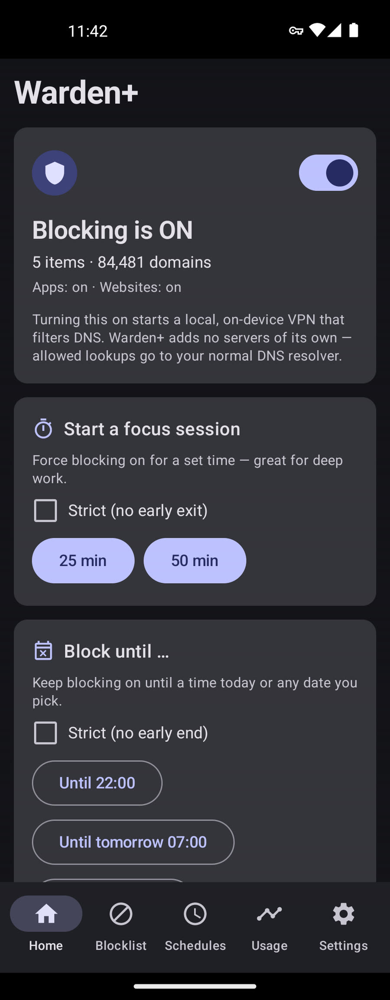](docs/images/home-dark.jpg) | [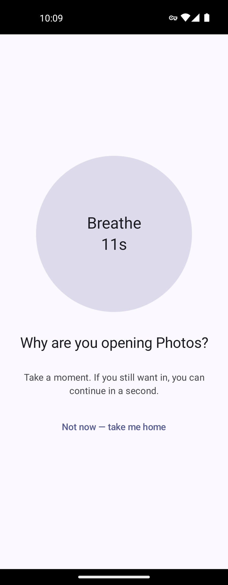](docs/images/pause-screen.jpg) |
| Same calm look in the dark theme. | Breathe first – then decide whether you really want to open the app. |

## First launch: setup wizard and guides

New installs open a **setup wizard** that walks through everything Warden+ needs: notifications, app blocking (including Android 13+ *restricted settings*), website blocking (and what to do if another VPN such as Tailscale is active), usage access, battery, protection level and device admin, and your first blocks. Each step ticks itself off when you come back from Android settings; optional steps can be skipped and continued later from a card on Home.

**Spotlight guides** highlight one thing at a time. When the next step is on another page, an animated finger shows the way there; steps inside Android settings are explained with small animated screens and a button that opens the real page. Taps outside a guide never dismiss it, and *Skip* asks first. Replay any guide from **Settings → Help → Restart guide**. Details: [docs/TOURS.md](docs/TOURS.md), [docs/SETUP_WIZARD.md](docs/SETUP_WIZARD.md).

## Protection levels

| Level | What it does | Setup |
| --- | --- | --- |
| **Block protection** | Loosening a block (switching off, deleting, shortening a time, ending focus early, weakening protection itself) needs your PIN, waits 15 min / 1 h / 24 h, or is impossible until a date. Tightening always works at once. | *Settings → Protection* |
| **Force-stop protection** | Device admin greys out *Force stop* and blocks uninstall; battery exemption and always-on VPN keep Warden+ running; interruptions are noticed and counted. | Checklist on the Protection page |
| **Settings guard** (opt-in) | Shows a clear warning and keeps a count when you open the pages that would switch Warden+ off; notices manual clock changes. It warns – it does not block. | *Settings → Protection* |
| **Maximum protection** (experts) | Device-owner mode: Android itself switches blocked apps off, the VPN can't be turned off, force stop / clear data / uninstall are locked, date & time are fixed. Always includes an **emergency exit** (at most a 24-hour wait) – never a state that needs a factory reset. | One-time over USB: [docs/DEVICE_OWNER.md](docs/DEVICE_OWNER.md) |

## How blocking works

| Layer | Mechanism | Blocks |
| --- | --- | --- |
| **Website filter** | A local, on-device `VpnService` answers DNS queries for blocked domains (and their subdomains) with a sinkhole and forwards the rest to your resolver. No traffic leaves the phone through Warden+. | Websites in every browser and app |
| **App blocking** | An `AccessibilityService` notices when a blocked app really opens in the foreground and shows the block or mindful-pause screen. | Apps, in-app feeds (Reels, Shorts …) |
| **Device owner** (optional) | `setPackagesSuspended` and device policies. | Apps at system level |

The architecture and privacy model of the original are described in [`SPEC.md`](SPEC.md) and [`SECURITY.md`](SECURITY.md).

## Install

1. Download the newest `warden-plus-<version>.apk` from **[Releases](https://github.com/desquerteur/warden-plus/releases/latest)** and open it on your phone; allow *Install unknown apps* for the app you opened it with.
   - If the original Warden or an old debug build is installed, **uninstall it first** (same package name, different signing key).
2. Follow the setup wizard.
   - **Android 13+:** if the accessibility switch is greyed out (*Restricted setting*), tap it once, then *Settings → Apps → Warden+ → ⋮ → Allow restricted settings*, and switch it on again. The wizard shows this with an animation.
   - **Other VPNs:** Android allows only one VPN at a time. If Tailscale or another VPN is active or set to *Always-on*, website blocking can't start – Warden+ tells you and opens the VPN settings.

## Updates

*Settings → Updates* checks this repository's latest release, shows the notes and installs the new version after verifying it is signed with the same key. Updates keep your data and – since 0.2.2 – the accessibility permission. An optional daily check notifies you of new versions.

## Build from source

You need **JDK 17+** and the **Android SDK (API 34)**.

```bash
./gradlew testDebugUnitTest assembleDebug   # app/build/outputs/apk/debug/app-debug.apk
```

Signed release builds and the release workflow: [docs/RELEASING.md](docs/RELEASING.md). Style rules for contributors: [docs/STYLE.md](docs/STYLE.md).

To stay in sync with the original project:

```bash
git remote add upstream https://github.com/ChristopherLaughlin/warden.git
git fetch upstream && git merge upstream/main
```

## Tests and observed results

- **413 JVM unit tests** (schedules and time windows, block protection rules, hosts parser and matcher, allow-only and categories, settings-guard detection, device-owner policies, updater, statistics, guides and wizard logic) – all green for 0.3.6.
- **Emulator acceptance runs** on an emulated Galaxy Z Fold 4 (Android 14, 904×2316 cover screen and 1812×2176 inner screen) for every release from 0.2.2 to 0.3.6: in-app updates, data migration, blocking, protection levels, device owner and emergency exit, wizard and guides, light/dark mode – **0 crashes, 0 ANRs** in the recorded runs.
- Each release is built from a clean checkout, signed with the release key and attached to its GitHub Release with a SHA-256 digest.

## Privacy

Everything stays on the phone. Warden+ has no account and no analytics; the DNS filter doesn't log domains, and statistics are stored locally only. The only network requests Warden+ makes itself are hosts-list downloads you add and the update check against this repository.

## Known limits

- Android always lets the phone's owner switch off accessibility or VPN in system settings, or force-stop an app. Warden+ makes this harder and **notices and reports it**; only device-owner mode can lock it down.
- After a force stop, Android doesn't restart an app by itself: the filter returns when Warden+ is opened (or after a reboot), and accessibility must be switched on again.
- With device admin, *Uninstall* stays visible (Android offers *Deactivate & uninstall*); *Force stop* is greyed out.
- Samsung-specific pages and behaviour have so far only been checked in the emulator – see the milestones above.

## License and attribution

[GPL-3.0](LICENSE), the same license as the original. Warden+ is a modified version of **Warden by Christopher Laughlin**; the modifications are listed above, in the [releases](https://github.com/desquerteur/warden-plus/releases) and in the git history after upstream commit `ad62876`. See [`NOTICE`](NOTICE).
